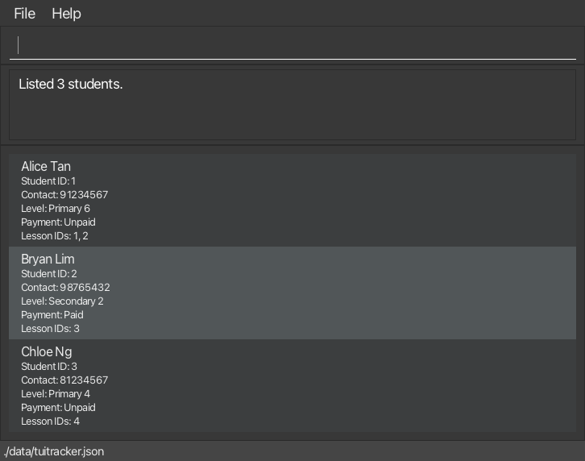

# TuiTracker User Guide

TuiTracker is a **desktop application for private tutors to manage their students, lessons, and monthly payments in one place**. It combines a Command Line Interface (CLI) with a Graphical User Interface (GUI), allowing tutors who type quickly to handle common administrative tasks efficiently while viewing their records clearly.

With TuiTracker, you can view student and lesson details, manage enrollments, track monthly payments, and remove records that are no longer needed.

<!-- * Table of Contents -->
<page-nav-print />

--------------------------------------------------------------------------------------------------------------------

## Quick start

1. Ensure that Java `25` or later is installed on your computer. 
   **Mac users:** Ensure you have the precise JDK version prescribed [here](https://se-education.org/guides/tutorials/javaInstallationMac.html).

1. Download the latest `tuitracker.jar` file from the [TuiTracker releases page](https://github.com/AY2627S1-CS2103T-T13-2/tp/releases).

1. Copy the file to the folder you want to use as the _home folder_ for TuiTracker.

1. Open a terminal, `cd` to the folder containing the JAR file, and run `java -jar tuitracker.jar`. 
   A GUI similar to the one below should appear in a few seconds. Note how the app contains some sample data. 
   

1. Type a command in the command box and press Enter to execute it. For example, type **`help`** and press Enter to open the help window. 
   Some example commands you can try:

   * `list` : Lists all students.

   * `list lessons` : Lists all lessons.

   * `add s/Alice Tan c/91234567 slv/Primary 6 l/Mathematics llv/Primary 6 d/Monday st/15:00 et/16:30 f/50.00` : Adds a student named `Alice Tan` to a new Mathematics lesson.

   * `mark 1` : Marks the student with ID 1 as paid for the current month.

   * `delete student 3` : Deletes the student with ID 3.

   * `exit` : Exits the app.

1. Refer to the [Features](#features) section below for details of each command.

--------------------------------------------------------------------------------------------------------------------

## Features

<box type="info" seamless>

**Notes about the command format:** 

* Words in `UPPER_CASE` are the parameters to be supplied by the user. 
  For example, in `delete student ID`, replace `ID` with a value such as `12`.

* Items in square brackets are optional. 
  For example, `list [students|lessons]` can be used as `list students`, `list lessons` or as just `list`.

* Parameters that start with a prefix, such as `s/` or `l/` in `add`, can be in any order. 
  For example, if the command specifies `s/STUDENT l/LESSON`, `l/LESSON s/STUDENT` is also acceptable.

* Extraneous parameters for commands that take no parameters, such as `help` and `exit`, are ignored. 
  For example, `help 123` is interpreted as `help`.

* If you are using a PDF version of this document, be careful when copying and pasting commands that span multiple lines as space characters surrounding line-breaks may be omitted when copied over to the application.
</box>

### Listing all students or lessons: `list`

Displays either all students or all lessons. Use this command to switch between the two lists or to clear an active filter.

**Format:** `list [students|lessons]`

**Parameters:**

* `students|lessons` — optionally specifies which list to display. The keyword is case-insensitive.
* If the parameter is omitted, TuiTracker displays the list of students.
* Leading and trailing spaces are ignored. Only one view may be specified.

**Examples:**

* `list` — displays all students.
* `list students` — displays all students.
* `list lessons` — displays all lessons.
* `list LESSONS` — displays all lessons; keyword case is ignored.

**Successful listing:**

* The selected list is displayed and any active filter is cleared.
* The result box reports the number of records, for example `Listed 3 students.` or `Listed 4 lessons.`
* If the selected list is empty, the result box displays `No students found. Use the add command to create one.` or `No lessons found. Lessons are created through the add command.`

**Displayed information:**

* The student list shows each student's name, ID, contact number, level, payment status for the current month, and enrolled lesson IDs. Students are ordered by ascending ID.
* The lesson list shows each lesson's subject, ID, level, weekly timeslot, fee per session, and enrolled students. Lessons are ordered by day of the week (Monday first), start time, then ID.

**Notes:**

* `list` and `list students` have the same effect.
* This command changes only the displayed list and filter. It does not modify any student, lesson, enrollment, or payment data.

**Errors:**

* An unknown view or extra text — the app displays `Invalid view. Use: list [students|lessons]`.
* More than one view — the app displays `The view can only be specified once.`

### Adding a student to a lesson: `add`

Enrolls a student in a lesson. The student and the lesson can each be **new** (the app creates them) or **existing** (you refer to them by their ID).

Format: `add s/STUDENT l/LESSON [c/CONTACT slv/STUDENT_LEVEL] [llv/LESSON_LEVEL d/DAY st/START_TIME et/END_TIME f/FEE]`

<box type="tip" seamless>

**Tip:** To find an ID, use `list students` or `list lessons` first.
</box>

#### How `s/` and `l/` work

* `s/` is the student. A **whole number**, such as `3`, means the existing student with that ID. Anything else, such as `Daniel Koh`, is the **name of a new student**.
* `l/` is the lesson. A **whole number**, such as `1`, means the existing lesson with that ID. Anything else, such as `Mathematics`, is the **subject of a new lesson**.
* A name or a subject must contain at least one letter, so it can never be mistaken for an ID.

Which other parameters you give depends on what is new. You can give the parameters in any order.

Student | Lesson | What you give
--------|--------|--------------
existing | existing | `s/ID l/ID`
new | existing | `s/NAME c/CONTACT slv/STUDENT_LEVEL l/ID`
existing | new | `s/ID l/SUBJECT llv/LESSON_LEVEL d/DAY st/START_TIME et/END_TIME f/FEE`
new | new | all of the above

#### Parameters

Parameter | Meaning | Needed when | Rules
----------|---------|-------------|------
`s/` | The student: an ID, or the name of a new student | always | A name has at most 100 characters: letters, numbers, spaces, apostrophes and hyphens, with at least one letter.
`l/` | The lesson: an ID, or the subject of a new lesson | always | A subject has at most 50 characters: letters, numbers, spaces and hyphens, with at least one letter.
`c/` | The student's contact number | the student is new | Digits only, from 3 to 15 digits.
`slv/` | The student's level, such as `Primary 6` | the student is new | 1 to 30 characters: letters, numbers, spaces and hyphens, with at least one letter or number.
`llv/` | The lesson's level, such as `Primary 6` | the lesson is new | The same as `slv/`.
`d/` | The day of the week | the lesson is new | `Monday` to `Sunday`, in any letter case.
`st/` | The start time | the lesson is new | In the 24-hour format `HH:mm`, such as `09:00`. A time such as `9:00` is not accepted.
`et/` | The end time | the lesson is new | In the same format, and later than the start time.
`f/` | The fee for one session | the lesson is new | More than zero, with at most two decimal places, such as `50` or `50.00`.

Using a parameter that does not belong, such as `c/` with an existing student, is an error.

#### Examples

Each one is followed by the result you should see.

1. `add s/Daniel Koh c/92223333 slv/Primary 6 l/1`: Enrolled Daniel Koh [Student ID: 4] in Mathematics [Lesson ID: 1]. Payment status: Unpaid.
1. `add s/3 l/Art llv/Primary 4 d/Tuesday st/10:00 et/11:00 f/40`: Enrolled Chloe Ng [Student ID: 3] in Art [Lesson ID: 5]. Payment status: Unpaid.
1. `add s/Eve Ong c/90001111 slv/Primary 4 l/Drama llv/Primary 4 d/Wednesday st/10:00 et/11:00 f/35`: Enrolled Eve Ong [Student ID: 5] in Drama [Lesson ID: 6]. Payment status: Unpaid.
1. `add s/4 l/2`: Enrolled Daniel Koh [Student ID: 4] in Science [Lesson ID: 2]. Payment status: Unpaid.
1. `add s/2 l/Physics llv/Secondary 2 d/Friday st/14:00 et/15:00 f/55`: Enrolled Bryan Lim [Student ID: 2] in Physics [Lesson ID: 7]. Payment status: Paid.

#### Possible sources of errors

Each of these starts from the sample data. The command is shown first, then the message you see.

Command | Message
--------|--------
`add s/1 l/1` | The student is already enrolled in this lesson.
`add s/1 l/4` | Student level does not match lesson level.
`add s/1 l/99` | No lesson found with ID 99.
`add s/99 l/1` | No student found with ID 99.
`add s/Alice Tan c/91234567 slv/Primary 6 l/1` | A student with the same name and contact already exists (Student ID: 1). Use the existing student ID.
`add s/1 l/Mathematics llv/Primary 6 d/Monday st/15:00 et/16:30 f/60` | An identical lesson already exists (Lesson ID: 1). Use the existing lesson ID.
`add s/1 l/History llv/Primary 6 d/Monday st/16:00 et/17:00 f/35` | Lesson clashes with an existing lesson.
`add s/Daniel Koh slv/Primary 6 l/1` | Missing required parameter: c/.
`add s/1 l/1 c/91234567` | c/ and slv/ can only be used when adding a new student.
`add s/1 l/1 d/Monday` | llv/, d/, st/, et/ and f/ can only be used when adding a new lesson.
`add s/1 s/2 l/1` | A parameter can only be specified once.
`add s/Daniel Koh c/12 slv/Primary 6 l/1` | Invalid contact. Contact must contain between 3 and 15 digits.
`add s/1 l/History llv/Primary 6 d/Monday st/9:00 et/10:00 f/35` | Invalid start time. Use the 24-hour format HH:mm.
`add` | Invalid command format. Use: add s/STUDENT l/LESSON [c/CONTACT slv/STUDENT_LEVEL] [llv/LESSON_LEVEL d/DAY st/START_TIME et/END_TIME f/FEE]

### Deleting a student or a lesson: `delete`

Deletes a student or lesson using its ID. Use this command when you want to remove a record from the app.

**Format:** `delete student|lesson ID`

**Parameters:**

* `student|lesson` — must be exactly `student` or `lesson` (case-insensitive). Abbreviations and repeating the keyword are not allowed.
* `ID` — the record's positive whole-number ID, up to `2147483647`. Leading zeros are allowed and ignored (for example, `0012` refers to ID `12`).
* Leading and trailing spaces are ignored. No other text may follow the ID.

**Examples:**

* `delete student 3` — deletes the student with ID 3.
* `delete lesson 2` — deletes the lesson with ID 2.
* `delete STUDENT 0012` — deletes student 12; keyword case and leading zeros are ignored.

**Successful deletion:**

* The result box confirms the deleted record, for example `Deleted student: Alice Tan (ID: 12)`.
* Deleting a lesson confirms its subject, level, timeslot and ID, for example `Deleted lesson: Mathematics | Primary 6 | Monday 15:00-16:30 (ID: 7)`.

**Notes:**

* Deleting a student also removes all of that student's enrollments. Deleting a lesson removes all enrollments tied to that lesson. Other student and lesson records remain.
* Deleting a record removes it from the displayed list when it is shown. An active filter stays in place; if it refers to the deleted record, its filtered list becomes empty until you change or clear the filter.
* The ID must be a positive whole number. For example, `delete student 0` and `delete student -1` are invalid.

**Errors:**

* Missing or unknown kind, an abbreviation, a repeated kind, a missing or malformed ID, or extra text after the ID — the app displays `Invalid command format. Use: delete student|lesson ID`.
* No record of the requested kind has that ID — the app displays `No student found with ID 999.` or `No lesson found with ID 999.` (using the requested ID). An ID belonging only to the other kind does not match. No data is changed on failure.

### Marking a student as paid: `mark`

Marks a student as paid for the current month using the student's ID. Use this command after receiving the student's payment for the current month.

**Format:** `mark ID`

**Parameters:**

* `ID` — the student's positive whole-number ID. Leading zeros are allowed and ignored (for example, `0012` refers to ID `12`).
* Leading and trailing spaces are ignored. No other text may follow the ID.

**Examples:**

* `mark 1` — marks the student with ID 1 as paid for the current month.
* `mark 0012` — marks student 12 as paid; leading zeros are ignored.

**Successful marking:**

* The result box confirms the student's name, for example `Marked Alice Tan as paid for the current month.`
* The student's payment status for the current month is updated to paid.

**Notes:**

* The command records payment only for the current month.
* A student who is already marked as paid for the current month cannot be marked again.
* Student IDs and lesson IDs are separate. The ID must belong to a student.
* The ID must be a positive whole number. For example, `mark 0` and `mark -1` are invalid.

**Errors:**

* A missing ID or extra text after the ID — the app displays `Invalid command format. Use: mark ID`.
* A malformed or non-positive ID — the app displays `ID must be a positive whole number.`
* No student has that ID — the app displays `No student found with ID 999.` (using the requested ID). An ID belonging only to a lesson does not match.
* The student is already marked as paid for the current month — the app displays `Alice Tan is already marked as paid for the current month.` (using the student's name).

No data is changed on failure.

### Showing a student's lessons or a lesson's students: `filter`

Shows only the lessons that one student is enrolled in, or only the students enrolled in one lesson.

Format: `filter student|lesson ID`

* Shows a student's lessons: `filter student ID`.
* Shows a lesson's students: `filter lesson ID`.
* The `ID` refers to the student ID or lesson ID shown in the displayed list, not its position in the list.
* The specified `ID` must belong to an existing student or lesson.
* Filtering replaces any earlier filter; only one filter can be active at a time.
* Filtering by a student switches the displayed list to **Lessons**; filtering by a lesson switches it to **Students**.
* To clear the filter and show every student and lesson again, use `list`.

Examples:
* `filter student 1` shows only the lessons that the student with ID `1` is enrolled in.
* `filter lesson 2` shows only the students enrolled in the lesson with ID `2`.

### Exiting the program: `exit`

Exits the program.

Format: `exit`

### Saving the data

TuiTracker automatically saves data after every command. You do not need to save manually.

### Editing the data file

TuiTracker data is saved automatically as a JSON file `[JAR file location]/data/tuitracker.json`. Advanced users are welcome to update data directly by editing that data file.

<box type="warning" seamless>

**Caution:**
If your changes make the data file invalid, TuiTracker starts with no students or lessons at the next run. The invalid file remains on disk until you run a command (TuiTracker saves after every command). Still, we recommend backing up the file before editing it. 
Furthermore, certain edits can cause TuiTracker to behave in unexpected ways (e.g., if a value entered is outside of the acceptable range). Therefore, edit the data file only if you are confident that you can update it correctly.
</box>

### Archiving data files `[coming in v2.0]`

_Details coming soon ..._

--------------------------------------------------------------------------------------------------------------------

## FAQ

**Q**: How do I transfer my data to another computer? 
**A**: Install the app on the other computer and overwrite the data file it creates with the data file from your previous TuiTracker home folder.

--------------------------------------------------------------------------------------------------------------------

## Known issues

1. **When using multiple screens**, if you move the application to a secondary screen, and later switch to using only the primary screen, the GUI will open off-screen. The remedy is to delete the `preferences.json` file created by the application before running the application again.
2. **If you minimize the Help Window** and then run the `help` command (or use the `Help` menu, or the keyboard shortcut `F1`) again, the original Help Window will remain minimized, and no new Help Window will appear. The remedy is to manually restore the minimized Help Window.

--------------------------------------------------------------------------------------------------------------------

## Command summary

Action     | Format, Examples
-----------|----------------------------------------------------------------------------------------------------------------------------------------------------------------------
**Add**    | `add s/STUDENT l/LESSON [c/CONTACT slv/STUDENT_LEVEL] [llv/LESSON_LEVEL d/DAY st/START_TIME et/END_TIME f/FEE]`   _Examples to be added by the owner of `add`._
**Delete** | `delete student\|lesson ID`   `delete student 3`, `delete lesson 2`
**Filter** | `filter student\|lesson ID`   e.g., `filter student 1`, `filter lesson 2`
**List**   | `list [students\|lessons]`   e.g., `list`, `list students`, `list lessons`
**Mark**   | `mark ID`   e.g., `mark 1`, `mark 0012`
**Help**   | `help`
**Exit**   | `exit`
